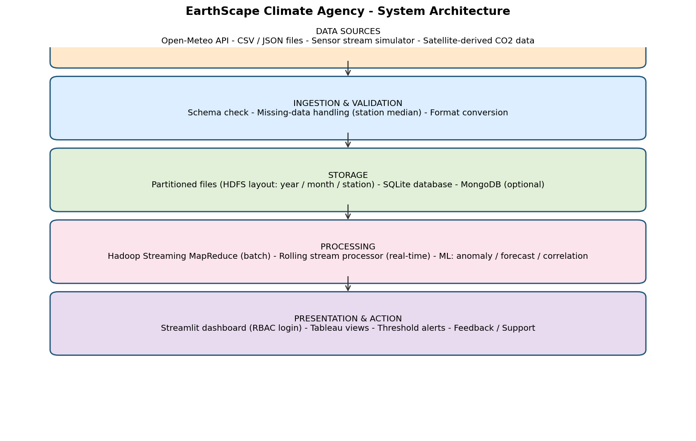

# EarthScape Climate Agency — Big Data Analytics Platform

A big-data platform that ingests climate data from weather stations, sensors and satellite-derived
sources, stores it in a partitioned (HDFS-style) store, processes it with **Hadoop MapReduce**,
applies **machine learning** for anomaly detection, trend forecasting and correlation analysis, and
presents everything through an interactive dashboard with automated threshold alerts.

Built as a five-member group eProject (Big Data) at Aptech, Karachi.



## Verified results (from the bundled dataset)
- **9,135** daily records · **5 stations** (Karachi, Lahore, Islamabad, Quetta, Peshawar) · 2020–2024
- **300** partitioned files (year / month / station) · **300** monthly MapReduce aggregates
- **30 anomalies** detected (per station-month z-score) · **578** threshold alerts
- Warming trend at every station, e.g. Karachi **+0.065 °C/year** · temperature vs humidity correlation **−0.71**
- **13/13** end-to-end tests pass (`tests/run_tests.py`) — see `docs/RESULTS.md` for full detail

## Features
- **Authentication & RBAC** — Admin / Analyst / Viewer accounts, configured via environment variables
- **Ingestion** — CSV/JSON validation with station-median imputation for missing values; a real-data
  fetcher for the free Open-Meteo Archive API; a real-time sensor stream simulator
- **Storage** — partitioned file store mirroring HDFS layout, SQLite database, MongoDB-ready JSON export,
  and the exact HDFS/Impala commands to reproduce it on a real cluster (`docs/HDFS_COMMANDS.md`)
- **Processing** — Hadoop Streaming MapReduce (Python mapper/reducer) that runs identically in local
  pipe mode and on a single-node/multi-node cluster
- **Machine learning** — anomaly detection (z-score per station-month, with IsolationForest as an
  independent second detector), least-squares trend forecasting, correlation analysis
- **Dashboard** — Streamlit app with 5 pages: Dashboard, Monthly (MapReduce) Analysis, ML Insights,
  Alerts, and Support tickets (plus an Admin ticket view)
- **Alerts** — configurable thresholds (temperature 42 °C, rainfall 100 mm, CO₂ 430 ppm)
- **Tableau** — views prepared from the MapReduce output CSV (`docs/TABLEAU.md`)

## Quick start (Windows / Linux, no Docker)
```bash
pip install -r requirements.txt
python src/generate_sample_data.py     # bundled synthetic dataset (fixed seed, reproducible)
# — or real data:  python src/fetch_openmeteo.py   (Open-Meteo, Karachi, free, no key)
python src/ingest.py                   # validation + partitioned storage
```

MapReduce:
```bash
# Linux/macOS
cat data/raw/climate_records.csv | python mapreduce/mapper.py | sort | python mapreduce/reducer.py
# Windows (PowerShell)
cmd /c "type data\raw\climate_records.csv | python mapreduce\mapper.py | sort | python mapreduce\reducer.py"
```

Database, tests, dashboard:
```bash
python database/build_db.py
python tests/run_tests.py
streamlit run app.py                   # http://localhost:8501
```
On Windows, `run_demo.bat` runs the whole pipeline and launches the dashboard in one click.

## Authentication
No credentials are stored in this repository. Set passwords in your environment before starting
the app (the username is the role name):
```bash
# Windows PowerShell
$env:EARTHSCAPE_ADMIN_PASSWORD="your-password"
$env:EARTHSCAPE_ANALYST_PASSWORD="your-password"   # optional
$env:EARTHSCAPE_VIEWER_PASSWORD="your-password"    # optional
```

## Project structure
```
app.py                  Streamlit dashboard (RBAC, 5 pages)
src/                    ingestion, ML models, alerts, Open-Meteo fetcher, data generator, backup
mapreduce/              Hadoop Streaming mapper + reducer
streaming/              real-time sensor stream simulator
database/               SQLite builder (+ MongoDB JSON export)
notebooks/              Jupyter EDA/ML notebook + R EDA script
diagrams/               architecture, DFD 0/1, flowchart, ER, use-case (PNG + generator script)
docs/                   results, HDFS commands, Tableau guide, viva prep, report outline
data/                   raw dataset + processed MapReduce/ML outputs
snapshots/              generated charts
tests/                  end-to-end test suite (13 tests)
```

## Assumptions & limitations
- Satellite data is ingested as satellite-derived tabular data; raw satellite image processing is out of scope.
- Hadoop runs in local / single-node Streaming mode; the same code scales to a multi-node cluster.
- The bundled dataset is synthetic (fixed seed) with injected anomalies and missing values for testing;
  the Open-Meteo fetcher provides the real-data path.
- Forecasts are linear-trend models, not deep-learning models.

## Author
**Sheikh Maaz Abdullah** — [github.com/sheikhmaazabdullah](https://github.com/sheikhmaazabdullah)

## License
MIT — see [LICENSE](LICENSE).
